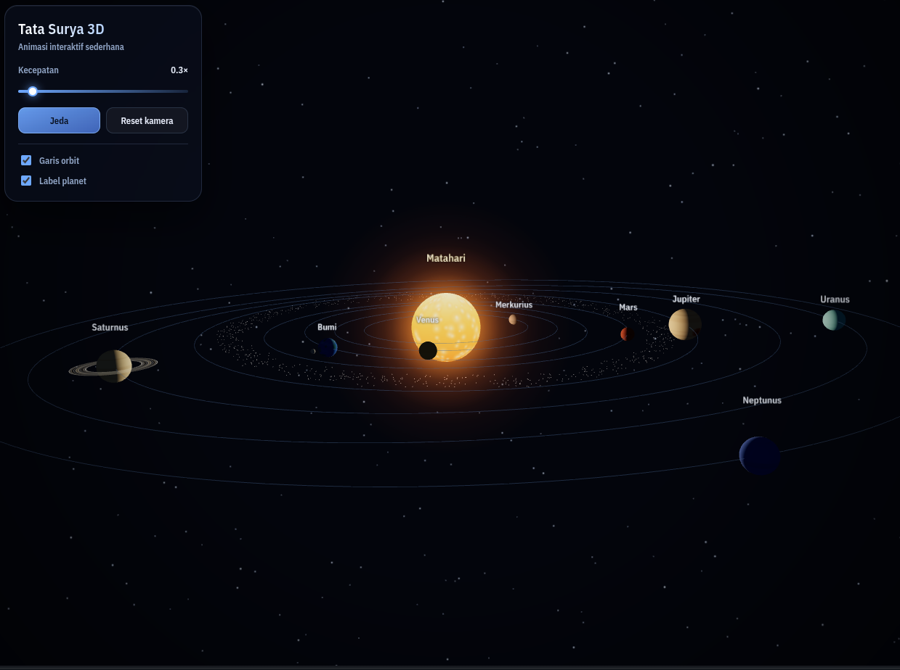

# Solar System 3D

An interactive 3D solar system that runs in the browser. Drag to orbit the camera,
scroll to zoom, and click any planet to fly over and read its facts. Built with
[Three.js](https://threejs.org/) and [Vite](https://vite.dev/) — no external image
assets, since every planet texture is generated procedurally on a canvas.




## Live demo

> `https://your-project.vercel.app`

## Features

- **Sun and all eight planets** with tilted orbits, individual revolution and
  rotation speeds, plus a moon for Earth and rings for Saturn.
- **Procedural visuals** — planet surfaces, the Sun's glow, Saturn's rings, the
  starfield, and the asteroid belt are all generated at runtime, so the repository
  stays asset-free.
- **Camera controls** — drag to rotate, scroll or pinch to zoom. The camera follows
  the selected planet while you keep full orbit control.
- **Click-to-inspect** — selecting a body smoothly flies the camera in and opens an
  info panel with distance from the Sun, orbital period, rotation period, moon count,
  and a short fact.
- **Time controls** — pause/resume, a 0–5× speed slider, and toggles for orbit lines
  and planet labels.
- **Responsive UI** — compact layout and touch-friendly controls on phones, with
  adaptive label sizing so names stay readable at any zoom level.
- **Stable timing** — one animation loop driven by `THREE.Timer`, with frame delta
  clamped so the simulation does not jump after a tab switch. Panel entrance
  animations respect `prefers-reduced-motion`.

## Controls

| Action | Result |
| --- | --- |
| Drag | Orbit the camera around the system |
| Scroll / pinch | Zoom in and out |
| Click / tap a body | Fly to it and open the info panel |
| Click empty space / `Esc` | Close the info panel and stop following |
| Speed slider | Change simulation speed from 0× to 5× |
| Pause button / `Space` | Pause or resume the animation |
| Reset camera | Return to the default view |
| Orbit lines / Labels | Show or hide orbit paths and planet names |

## Tech stack

- [Three.js](https://threejs.org/) — WebGL rendering, scene graph, raycasting
- [Vite](https://vite.dev/) — dev server and production build
- Vanilla JavaScript (ES modules) and CSS — no UI framework
- HTML Canvas — procedural texture generation

## Getting started

### Requirements

- Node.js **20.19+** or **22.12+** (required by Vite 8)
- npm (or pnpm/yarn, adjusting commands accordingly)

### Install and run

```bash
git clone https://github.com/Rafiitarse/website-3d.git
cd website-3d
npm install
npm run dev
```

Open the URL printed by Vite, usually <http://localhost:5173>.

### Available scripts

| Command | Description |
| --- | --- |
| `npm run dev` | Start the Vite dev server with hot module replacement |
| `npm run build` | Build the production bundle into `dist/` |
| `npm run preview` | Serve the built bundle locally to verify it |

## Project structure

```
.
├── index.html            # Page markup, HUD, and info panel
├── vite.config.js        # Relative base path + build settings
├── src/
│   ├── main.js           # Renderer, camera, OrbitControls, animation loop
│   ├── solarSystem.js    # Planet data, meshes, orbits, stars, asteroid belt
│   ├── textures.js       # Canvas-based procedural texture generators
│   ├── interaction.js    # Raycasting, hover, focus tween, camera follow, reset
│   ├── ui.js             # Slider, buttons, toggles, info panel rendering
│   └── style.css         # Glass panels, responsive layout, reduced-motion rules
└── README.md
```

## How it works

- **Scene setup** — `createSolarSystem()` builds the Sun, planets, moons, rings,
  orbit lines, starfield, and asteroid belt, then returns an `update(delta)` function
  that advances every orbit and rotation.
- **Scaling** — sizes and distances are compressed for readability, not astronomical
  accuracy. Orbital angular speed is derived from distance:
  `ORBIT_BASE * (EARTH_DISTANCE / distance) ** 1.5`, so inner planets naturally orbit
  faster than outer ones.
- **Focus camera** — clicking a body starts a short eased tween. Once it finishes, the
  camera is translated by the planet's per-frame movement, which keeps the selected
  body centered without taking away the user's orbit angle or zoom.
- **Labels** — sprites are rescaled each frame based on camera distance and viewport
  aspect ratio, keeping them legible both when zoomed out and when up close.
- **Hit areas** — invisible spheres larger than each planet make small bodies easy to
  click or tap on touch screens.

## Customizing

Planet definitions live in the `PLANETS` array in `src/solarSystem.js`:

```js
{
  id: 'bumi',
  name: 'Bumi',
  radius: 0.88,          // visual size
  distance: 14.5,        // orbit radius
  inclination: 0,        // orbit tilt in radians
  spin: 0.55,            // rotation speed
  texture: { base: '#1f5fbf', accent: '#2f8f4f', continents: true },
  moon: { radius: 0.22, distance: 1.9, speed: 0.9 },
  info: { jarak: '...', revolusi: '...', rotasi: '...', bulan: '1', fakta: '...' },
}
```

Other common tweaks:

- **Animation speed** — change `ORBIT_BASE` in `src/solarSystem.js`.
- **Initial camera view** — edit `HOME_POSITION` in `src/main.js`.
- **Label size** — adjust the `height` argument in `makeLabelSprite()`.
- **UI language** — the interface currently ships in Indonesian. Copy lives in
  `index.html` plus `src/ui.js` (panel field labels are the `INFO_FIELDS` array), and
  each planet's `info` object holds its own panel text.
- **New body** — append an entry to `PLANETS`; the loop automatically builds its mesh,
  orbit line, label, and click target.

## Deploying to Vercel

The project is a static single-page app, so no server or rewrites are required.
`vite.config.js` already sets `base: './'`, which keeps asset paths relative and lets
the build run from any subdirectory.

### Option 1 — Vercel dashboard

1. Push the repository to GitHub.
2. Go to [vercel.com/new](https://vercel.com/new) and import the repository.
3. Vercel auto-detects Vite. Confirm the settings:
   - **Framework preset:** Vite
   - **Build command:** `npm run build`
   - **Output directory:** `dist`
4. Click **Deploy**. Every push to the default branch redeploys automatically.

### Option 2 — Vercel CLI

```bash
npm install -g vercel
vercel          # first run: link the project and create a preview deployment
vercel --prod   # promote to production
```

### Other static hosts

Because the output is plain HTML/CSS/JS, `dist/` can be served by GitHub Pages,
Netlify, Cloudflare Pages, or any static file server. No environment variables are
needed.

## Browser support

Requires a browser with WebGL 2 enabled — current versions of Chrome, Edge, Firefox,
and Safari (including iOS Safari) are supported. On low-end devices the renderer caps
pixel ratio at 2 and uses a single animation loop to keep the frame rate stable.

## Notes and limitations

- Planet sizes, distances, and orbital speeds are stylized, not to scale.
- The simulation state is not persisted between reloads.
- No audio, VR mode, or backend — the whole experience is client-side.
- The Three.js bundle is around 580 kB uncompressed (~146 kB gzipped); this is normal
  for a 3D app and is cached by the browser after the first load.

## Credits

- [Three.js](https://threejs.org/) — 3D rendering engine
- [Vite](https://vite.dev/) — build tooling
- Planet facts adapted from general NASA reference material

## License

MIT
